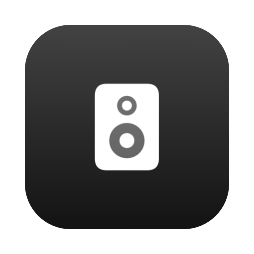
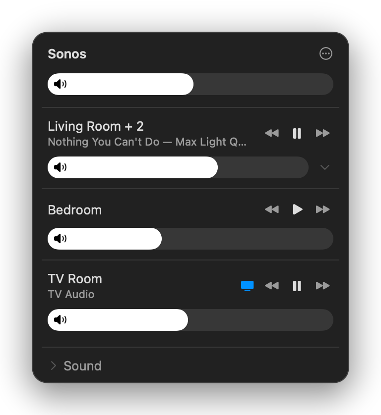
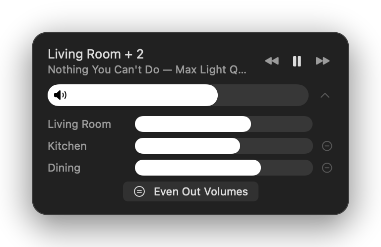
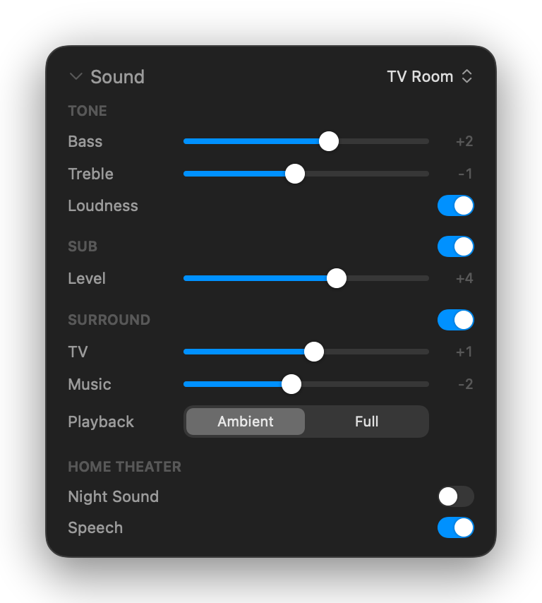

<div align="center">



# SonoMac

**Sonos control that feels built into macOS.**

A tiny native menu bar app for your Sonos system — whole-house volume, grouping, playback,
per-room EQ and TV audio, styled like Control Center. No cloud, no account, no Electron.
One sub-megabyte binary that talks to your speakers directly.

[](https://github.com/inakizamores/SonoMac/releases/latest)
[](https://github.com/inakizamores/SonoMac/releases)
[](#requirements)
[](#requirements)
[](Sources/SonoMac)
[](LICENSE)

<br>

&nbsp;



</div>

---

## Install

**[⬇ Download SonoMac.dmg](https://github.com/inakizamores/SonoMac/releases/latest/download/SonoMac.dmg)**, open it, drag **SonoMac** onto **Applications**, and launch it from there. The speaker icon appears in your menu bar.

Prefer the Terminal? This installs and launches it in one line, no dialogs:

```bash
curl -fsSL -o /tmp/SonoMac.zip https://github.com/inakizamores/SonoMac/releases/latest/download/SonoMac.zip && ditto -xk /tmp/SonoMac.zip /Applications && xattr -dr com.apple.quarantine /Applications/SonoMac.app && open /Applications/SonoMac.app
```

### First launch — telling macOS to trust the app

SonoMac is open source and **not notarized by Apple** (notarization requires a paid Apple
Developer subscription). macOS therefore warns you once. This is expected — here's the
official Apple flow to approve it:

1. Double-click **SonoMac** in Applications. macOS shows *"Apple could not verify SonoMac
   is free of malware"* — click **Done** (not *Move to Trash*).
2. Open **System Settings → Privacy & Security**.
3. Scroll down to the Security section — you'll see *"SonoMac was blocked to protect your
   Mac"*. Click **Open Anyway**.
4. Confirm with your password or Touch ID. macOS remembers the decision — you'll never be
   asked again, including after updates you install the same way.

Skeptical? Good instinct. The entire app is in this repository — you can read every line
and [build it yourself](#build-from-source) in under a minute.

### Local Network permission

On first open of the panel, macOS asks for **Local Network** access. Click **Allow** —
that's how SonoMac finds and controls your speakers. That's the entire setup: no account,
no configuration, no pairing.

## Features

### Volume
- **Master slider** — one bar moves every room in the house proportionally
- **Room & group volume** — Control-Center-style capsule bars, one per room
- **Per-speaker volume** — expand any grouped room with the chevron for individual bars
- **Even Out Volumes** — one click sets every speaker in a group to the group average
  (70 / 60 / 50 → 60 / 60 / 60), like the modern Sonos app; the ⋯ menu can level the
  entire house the same way
- **Drift-proof groups** — volume ratios are snapshotted at drag start (the same
  `SnapshotGroupVolume` mechanism the Sonos app uses), so evened-out speakers stay
  perfectly even while you move the group or master slider
- **Mute** — click the speaker glyph on any bar; the glyph's waves track the level

### Playback
- **Play / pause / previous / next** per room, with a now-playing line
- **TV Audio** — one click switches home-theater rooms (Arc, Beam, Ray, Playbar,
  Playbase, Amp) to TV input and back to the queue

### Rooms & grouping
- **Group With…** — right-click any room to merge it into another room's group
- **Separate Speakers / remove one speaker** — break groups apart from the same menu
- **Group All / Separate All** — party mode and back, from the ⋯ menu

### Sound settings
- Per-room **Bass / Treble** and **Loudness**
- **Subwoofer** on/off and level, **Surrounds** on/off with separate TV and Music levels,
  Ambient/Full music playback for surrounds
- **Night Sound** and **Speech Enhancement** for home-theater rooms

### The apparatus
- **Start at Login** — always ready, never in your Dock
- **Instant panel** — rooms and levels render from cached state the moment it opens;
  live values glide in behind
- **Zero background cost** — polls only while the panel is open; closed, it does nothing

## Everyday use

| Gesture | Effect |
|---|---|
| Click menu bar icon | Open the panel |
| Drag any volume bar | Set level (tracks 1:1) |
| Two-finger swipe on a bar | Nudge level — damped so it can never jump |
| Click the speaker glyph | Mute / unmute that room (or everything, on the master) |
| Chevron on a grouped room | Show per-speaker bars |
| Right-click a room | Group With… · Separate Speakers · Even Out Volumes |
| ⋯ menu | Group All · Separate All · Sound settings · Start at Login · Rescan |

## How it works

- Talks the same local UPnP/SOAP API the Sonos app uses (`AVTransport`,
  `RenderingControl`, `GroupRenderingControl`, `ZoneGroupTopology`) directly to your
  speakers on port 1400 — no Sonos account, no cloud round-trips
- Discovery via SSDP multicast, with last-known speaker addresses cached so reconnecting
  is instant even when multicast is slow
- Volume writes are throttled (~8/s) with echo suppression, so polling never fights your
  drag; failed commands retry once
- Pure Swift + SwiftUI `MenuBarExtra`. Zero third-party dependencies. Single arm64 binary.

## Privacy

Everything stays on your LAN. SonoMac makes no connection to any server that isn't a
Sonos speaker on your network. No analytics, no telemetry, no crash reporting, no
update phone-home. The app cannot see your Sonos account because it never asks for one.

## Requirements

- macOS 14 Sonoma or later, Apple Silicon
- A Sonos S2 system on the same network as the Mac

## Troubleshooting

- **No speakers found** — make sure the Mac is on the same network/VLAN as the speakers,
  then check **System Settings → Privacy & Security → Local Network** has SonoMac enabled,
  then use **⋯ → Rescan Network**.
- **Panel shows stale rooms after network change** — Rescan Network re-discovers from
  scratch.
- **Volume moves but no sound changes** — another controller may have the group muted;
  click the speaker glyph.

## Build from source

Only Xcode Command Line Tools required (`xcode-select --install`) — no Xcode, no
dependencies:

```bash
git clone https://github.com/inakizamores/SonoMac.git
cd SonoMac
./build.sh --install
```

`./build.sh` produces `build/SonoMac.app`; `--install` copies it to /Applications and
launches it. `./release.sh` builds the distributable DMG and zip. Tagged `v*` pushes are
built and published automatically by GitHub Actions on macOS 26 runners (the workflow
refuses to ship a build linked against an older SDK, which would render with legacy
window chrome).

## Sibling project

Control an Onkyo/Integra AV receiver the same way: **[OnkyoMac](https://github.com/inakizamores/OnkyoMac)** —
same design, same philosophy, eISCP protocol.

## License

[MIT](LICENSE) — do whatever you like with it.
